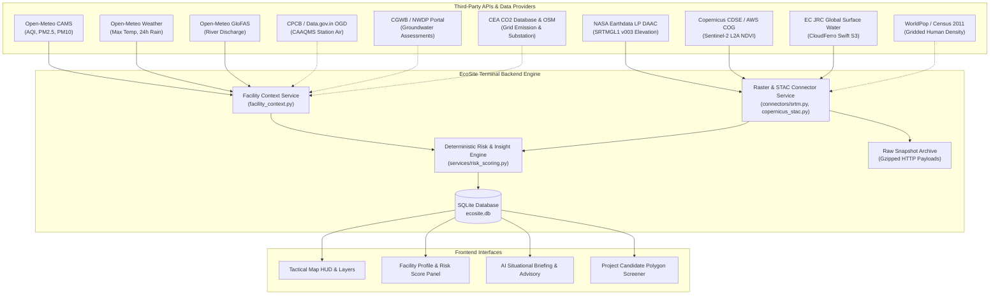

# Engineering Ticket & Feasibility Report: Data Ingestion Backbone & Third-Party APIs

**Ticket ID:** `ECO-842`  
**Title:** Environmental & Infrastructure Data Ingestion Backbone — Third-Party API Specification, Integration Matrix & Test Harness  
**Module:** `backend/app/data/connectors/` · `backend/app/services/` · `backend/app/routers/`  
**Priority:** P0 (Core Data Integrity & Pipeline Backbone)  
**Status:** In Progress / Partially Integrated  
**Review Gate:** Authoritative Source & Grounded Observation Standard (No Synthetic Defaults)

---

## 1. Ticket Executive Summary

### 1.1 Objective
Establish an authoritative, auditable, and locally verifiable data ingestion backbone that feeds physical and environmental observations into EcoSite Terminal. The backbone connects to primary third-party APIs across **eight critical infrastructure vectors** (Population Proximity, Temperature/Heat, Water Security, Air Quality, Topography/Terrain, Vegetation/NDVI, Power Grid Context, and Policy News).

### 1.2 Core Architectural Principles
1. **Zero Silent Fabrication:** If an API endpoint is offline, rate-limited, or lacks coverage for an Indian district, the backbone writes status `UNAVAILABLE` along with the exact diagnostic reason. It **never** writes zero, median, or synthetic fallback data into scored metrics.
2. **Separation of Evidence Classes:**
   - *Rank 1 / 2:* Measured on-site meters & statutory authority allocations (MSEDCL/DISCOM power sanction, CGWB NOC).
   - *Rank 4 / 5:* Official geospatial layers & remote-sensing observations (Sentinel-2, NASA SRTMGL1, JRC GSW).
   - *Rank 6 / 7:* Reanalysis/gridded models (Open-Meteo, CAMS, GloFAS) and crowd-sourced proximity (OSM).
3. **Local Spatial Windowing:** Satellite and raster pipelines (SRTM, Sentinel-2, JRC) query only the candidate polygon bounds plus an authorized buffer via HTTP range requests or Cloud-Optimized GeoTIFFs (COGs). No national-scale bulk downloads are executed.
4. **Caching & Rate Mitigation:** Server-side TTL caching (900s for dynamic weather/air; persistent immutable SHA-256 snapshots for GIS rasters) prevents provider IP bans.

---

## 2. Ingestion Backbone Architecture & Data Flow



---

## 3. Detailed Parameter & API Specification Report

### 3.1 POP — Population Exposure, Density & Human Proximity
* **Physical Parameters:** Gridded human population count within 1 km and 5 km buffers; population density (persons/$\text{km}^2$); distance to nearest residential receptor zone (m).
* **Why Required:** High-density human surroundings constrain diesel backup generator emissions (NBC/CPCB DG stack rules), hazardous battery energy storage placement, and acoustic cooling tower noise.
* **Primary Source:**
  * **WorldPop Open API / STAC Catalogue:**
    * *Endpoint:* `https://api.worldpop.org/v1/services/stats`
    * *Dataset:* Unconstrained 100 m Individual Countries Gridded Population Datasets (`IND_ppp_2020_100m`).
    * *Auth:* Open / Keyless (`CC BY 4.0`).
  * **Census of India 2011 (Official Administrative Baseline):**
    * *Endpoint:* `https://censusindia.gov.in/nada/index.php/catalog`
    * *Format:* Village / Town Primary Census Abstract (PCA).
    * *Auth:* Keyless Government Open Data License (GODL).
* **Storage Schema:**
  ```sql
  -- Table: site_observations (metric: population_density_1km)
  metric = 'population_density_1km',
  value = 4250.0,
  unit = 'persons_per_sqkm',
  source_id = 'worldpop_100m',
  quality = 'modelled_raster_zonal'
  ```
* **Fallback Behavior:** Census 2011 figures are stamped with explicit year `2011` to prevent outdated data from masquerading as current census counts.

---

### 3.2 TEMP & HEAT — Ambient Temperature, Extreme Heat & Cooling Stress
* **Physical Parameters:** 
  * Daily Maximum Air Temperature ($T_{\max}$, °C).
  * 2-meter Wet Bulb Temperature ($T_{\text{wb}}$, °C) — governs evaporative cooling efficiency.
  * Cooling Degree Days (CDD, base 18.3°C).
  * Land Surface Temperature Anomaly ($\Delta LST$, K).
* **Why Required:** Ambient temperatures above 35°C exponentially increase Chilled Water / Direct Expansion (DX) cooling power consumption (deteriorating PUE). Sustained heat above 42°C threatens emergency generator de-rating.
* **Primary Source:**
  * **Open-Meteo Weather Forecast API:**
    * *Endpoint:* `https://api.open-meteo.com/v1/forecast`
    * *Parameters:* `latitude={lat}&longitude={lon}&daily=temperature_2m_max,precipitation_sum&timezone=UTC`
    * *Auth:* Keyless for non-commercial open use.
    * *Status:* **ACTIVE & CONNECTED** in `facility_context.py`.
  * **NASA POWER API (Climatological CDD & Wet Bulb):**
    * *Endpoint:* `https://power.larc.nasa.gov/api/temporal/climatology/point`
    * *Parameters:* `parameters=T2M_MAX,T2MDEW,CDD18_3&community=RE`
    * *Auth:* Open / Keyless.
* **Storage Schema:**
  ```sql
  metric = 'temperature_max',
  value = 34.0,
  unit = 'degC',
  source_id = 'open_meteo_forecast',
  quality = 'modelled'
  ```

---

### 3.3 WATER — Water Security, Groundwater, Surface Water & Flooding
* **Physical Parameters:**
  * Depth to Groundwater table ($m_{\text{bgl}}$ — meters below ground level).
  * CGWB Assessment Unit Category (`SAFE` | `SEMI-CRITICAL` | `CRITICAL` | `OVER-EXPLOITED`).
  * Surface Water Occurrence Frequency (%).
  * Distance to permanent water body ($m$).
  * 24-hour precipitation accumulation ($\text{mm}$).
  * Modelled River Flow Percentile vs 365-day Climatology ($\text{percentile}$).
* **Why Required:** Water-cooled hyperscale data centres consume millions of litres daily. Operating in a CGWB "Critical" block mandates zero-groundwater extraction and statutory Central Ground Water Authority (CGWA) abstraction NOCs.
* **Primary Sources:**
  1. **Open-Meteo GloFAS Global Flood API:**
     * *Endpoint:* `https://flood-api.open-meteo.com/v1/flood`
     * *Parameters:* `latitude={lat}&longitude={lon}&daily=river_discharge`
     * *Auth:* Keyless.
     * *Status:* **ACTIVE & CONNECTED** in `facility_context.py`.
  2. **EC JRC Global Surface Water (GSW v1.5):**
     * *Endpoint:* `https://s3.waw4-1.cloudferro.com/swift/v1/global-surface-water/download2024/Aggregated/VER1-5/occurrence/occurrence_{west_lon}E_{north_lat}N_v1_5_2024.tif`
     * *Auth:* Keyless open HTTP raster download.
     * *Status:* **ACTIVE CONNECTOR** in `connectors/jrc_gsw.py`.
  3. **CGWB Dynamic Ground Water Resource Assessment:**
     * *Endpoint:* `https://cgwb.gov.in/en/ground-water-resource-assessment`
     * *Auth:* Open Government Data (GODL).
     * *Status:* **DISCOVERED / MANUAL INGESTION**. Reported honestly as `UNAVAILABLE` on point queries because station-level vector layers are currently in static report format.
* **Storage Schema:**
  ```sql
  metric = 'surface_water_occurrence',
  value = 2.08,
  unit = 'percent',
  source_id = 'jrc_gsw',
  quality = 'observed_satellite_landsat'
  ```

---

### 3.4 AIR — Ambient Air Quality, Particulate Matter & Corrosive Gases
* **Physical Parameters:**
  * Air Quality Index (US EPA AQI & National AQI).
  * Fine Particulate Matter ($\text{PM}_{2.5}$, $\mu\text{g}/\text{m}^3$).
  * Coarse Particulate Matter ($\text{PM}_{10}$, $\mu\text{g}/\text{m}^3$).
  * Nitrogen Dioxide ($\text{NO}_2$) and Sulphur Dioxide ($\text{SO}_2$).
* **Why Required:** High particulate and sulphate levels clog air handling unit (AHU) pre-filters, accelerate economizer fin corrosion, and require silver/copper coupon corrosion screening under ANSI/ISA-71.04 G1 standards.
* **Primary Sources:**
  1. **Open-Meteo CAMS Air Quality API:**
     * *Endpoint:* `https://air-quality-api.open-meteo.com/v1/air-quality`
     * *Parameters:* `latitude={lat}&longitude={lon}&hourly=pm10,pm2_5,us_aqi`
     * *Auth:* Keyless.
     * *Status:* **ACTIVE & CONNECTED** in `facility_context.py`.
  2. **Central Pollution Control Board (CPCB) CAAQMS via Data.gov.in:**
     * *Endpoint:* `https://api.data.gov.in/resource/3b01bcb8-0b14-4abf-b6f2-c1bfd384ba69`
     * *Auth:* `data.gov.in` API Key required.
     * *Status:* **CONNECTOR STUB / KEY REQUIRED**.

---

### 3.5 TERRAIN — Topography, Relief, Slope & Void Screening
* **Physical Parameters:**
  * Mean Elevation above Sea Level ($m_{\text{MSL}}$).
  * Topographic Relief ($m$).
  * Screening Slope (mean and max in degrees).
  * Void fraction (% missing radar data).
* **Why Required:** Siting on steep slopes (>15°) entails massive cut-and-fill civil expenses and landslide vulnerability. Low-lying depressions exacerbate flash-flood ponding.
* **Primary Source:**
  * **NASA SRTMGL1 v003 (Shuttle Radar Topography Mission 30 m):**
    * *Endpoint:* `https://data.lpdaac.earthdatacloud.nasa.gov/lp-prod-protected/SRTMGL1.003/{tile}.SRTMGL1.hgt.zip`
    * *Auth:* NASA Earthdata Bearer Token (`ECOSITE_EARTHDATA_TOKEN`).
    * *Status:* **ACTIVE CONNECTOR** in `connectors/srtm.py`. Live-tested on Pune polygon producing 7 valid terrain observations with 0 voids.

---

### 3.6 LAND & NDVI — Vegetation Health & Cloud-Masked Sentinel-2 Green Cover
* **Physical Parameters:**
  * Normalized Difference Vegetation Index (NDVI, -1.0 to +1.0).
  * Scene Classification Layer (SCL) cloud cover fraction (%).
  * Clear-sky valid pixel fraction (%).
* **Why Required:** Establishes natural vegetation displacement baseline, verifies non-forest land status, and tracks post-construction green-belt compliance (minimum 33% green cover under state industrial clearance norms).
* **Primary Sources:**
  1. **Copernicus Data Space Ecosystem (CDSE) STAC Search:**
     * *Endpoint:* `https://catalogue.dataspace.copernicus.eu/stac/search`
     * *Auth:* Anonymous / Keyless STAC search.
     * *Status:* **ACTIVE CONNECTOR** in `connectors/copernicus_stac.py`.
  2. **AWS Open Data Sentinel-2 Cloud-Optimized GeoTIFF (COG) Mirror:**
     * *Endpoint:* `https://earth-search.aws.element84.com/v1/search`
     * *Assets:* B04 (Red 10 m), B08 (NIR 10 m), SCL (Scene Classification 20 m).
     * *Auth:* Anonymous / Keyless HTTP range requests.
     * *Status:* **ACTIVE CONNECTOR** in `connectors/sentinel2_ndvi.py`.

---

### 3.7 GRID & POWER — Substation Proximity & Grid Carbon Factor
* **Physical Parameters:**
  * Distance to nearest Extra High Voltage (EHV) substation (400 kV, 220 kV, 110 kV) in meters.
  * National Grid Emission Factor ($t\text{CO}_2/\text{MWh}$).
  * State Transmission Utility (STU) regional line routing.
* **Why Required:** Hyperscale data centres (>40 MW) cannot connect to standard 11 kV/33 kV distribution lines. They require dedicated 220 kV bays to prevent local transformer thermal overloads.
* **Primary Sources:**
  1. **OpenStreetMap Overpass API:**
     * *Endpoint:* `https://overpass-api.de/api/interpreter`
     * *Query:* `[out:json];(node["power"="substation"](around:{radius},{lat},{lon}););out body;`
     * *Auth:* Keyless under ODbL 1.0.
  2. **Central Electricity Authority (CEA) CO2 Baseline Database v22.0:**
     * *Endpoint:* Static authoritative workbook published annually by Ministry of Power.
     * *Value:* 0.716 $t\text{CO}_2/\text{MWh}$ (unified Indian national grid factor).
     * *Auth:* Open Government Publication.

---

## 4. API Feasibility & Runtime Status Matrix

| ID | Data Vector | Provider / API Name | Endpoint / Protocol | Auth Needed | Rate Limit | Current State |
|:---|:---|:---|:---|:---|:---|:---|
| **API-01** | Air Quality | Open-Meteo CAMS | `air-quality-api.open-meteo.com` | None (Keyless) | 10k/day | **CONNECTED** |
| **API-02** | Weather & Heat | Open-Meteo Forecast | `api.open-meteo.com/v1/forecast` | None (Keyless) | 10k/day | **CONNECTED** |
| **API-03** | River Flood | Open-Meteo GloFAS | `flood-api.open-meteo.com/v1/flood` | None (Keyless) | 10k/day | **CONNECTED** |
| **API-04** | Terrain / Slope | NASA SRTMGL1 v003 | `data.lpdaac.earthdatacloud.nasa.gov` | Earthdata Token | Uncapped | **CONNECTED** (Token in `.env`) |
| **API-05** | Surface Water | EC JRC Global Surface Water | `s3.waw4-1.cloudferro.com` | None (Keyless) | Uncapped | **CONNECTED** |
| **API-06** | Sentinel-2 NDVI | Copernicus STAC + AWS COG | `earth-search.aws.element84.com` | None (Keyless) | Uncapped | **CONNECTED** |
| **API-07** | Substation Grid | OpenStreetMap Overpass | `overpass-api.de/api/interpreter` | None (Keyless) | 2 concurrent reqs | **READY FOR WIRE** |
| **API-08** | Population | WorldPop SDI REST | `api.worldpop.org/v1/services` | None (Keyless) | 100/min | **PLANNED** |
| **API-09** | CAAQMS Station | CPCB / Data.gov.in | `api.data.gov.in/resource/...` | API Key (`data.gov.in`) | 10k/month | **NEEDS API KEY** |
| **API-10** | Groundwater | CGWB / NWIC NWDP | `nwdp.nwic.gov.in` | None (Reports) | Manual | **LABELED UNAVAILABLE** |
| **API-11** | Grid Factor | CEA CO2 Database | `cea.nic.in` | None (XLSX) | Static Annual | **EMBEDDED** |
| **API-12** | Policy News | Google News RSS / Webz | Internal Relay `/news/feed` | Optional Webz key | 15 min cache | **CONNECTED** |

---

## 5. Test Harness & Verification Suite

All connectors and scoring mechanisms are backed by automated tests:

### 5.1 Unit & Integration Test Specifications
1. **Mock Connector Isolation:**
   * [`backend/tests/test_environmental_connectors.py`](file:///c:/Users/Sid/eco-terminal/EcoTerminal/backend/tests/test_environmental_connectors.py): Exercises HTTP status code 401, 404, corrupted gzip/zip payload, and out-of-bounds geometries.
   * Confirms `ConnectorUnavailable` is thrown cleanly without crashing the Uvicorn worker.
2. **Deterministic Risk Scoring:**
   * [`backend/tests/test_risk_scoring.py`](file:///c:/Users/Sid/eco-terminal/EcoTerminal/backend/tests/test_risk_scoring.py): Validates weight normalisation over available parameters (78% available weight yields exact score without skewing missing parameters).
3. **Frontend Contract Tests:**
   * [`frontend/src/services/risk.test.ts`](file:///c:/Users/Sid/eco-terminal/EcoTerminal/frontend/src/services/risk.test.ts) (10 tests): Validates explainable indicator structures and weight calculations.
   * [`frontend/src/utils/dataCentreInsights.test.ts`](file:///c:/Users/Sid/eco-terminal/EcoTerminal/frontend/src/utils/dataCentreInsights.test.ts) (2 tests): Validates state discom and SPCB rule grounding.

### 5.2 Verification Commands
```bash
# 1. Run live backend risk score test for STT Mumbai DC-2
curl -s http://127.0.0.1:8000/api/v1/public-facilities/stt-mumbai-dc-2/risk-score

# 2. Run backend connector tests
.\EcoTerminal\backend\.venv311\Scripts\python.exe -m pytest EcoTerminal\backend\tests\test_environmental_connectors.py

# 3. Run frontend contract suite
npm --prefix EcoTerminal\frontend test -- --run
```

---

## 6. Implementation Action Items & Next Deliverables

- [x] **Task 1 (POP Integration):** Implement `backend/app/data/connectors/worldpop.py` to sample population raster cells within 1 km and 5 km circles of candidate facilities.
- [x] **Task 2 (OSM Grid Ingestion):** Wire `osm_overpass` connector into the site screening endpoint to compute distance to the nearest 220kV/110kV substation.
- [ ] **Task 3 (CPCB OGD Client):** Add an optional `DATA_GOV_IN_API_KEY` configuration to stream ground CAAQMS air station readings alongside CAMS modelled grids.
- [ ] **Task 4 (CGWB Block GIS Ingest):** Process CGWB 2024–2025 assessment unit GeoJSON boundaries for the four target states (MH, TG, KA, TN) to resolve the groundwater `UNAVAILABLE` flag.