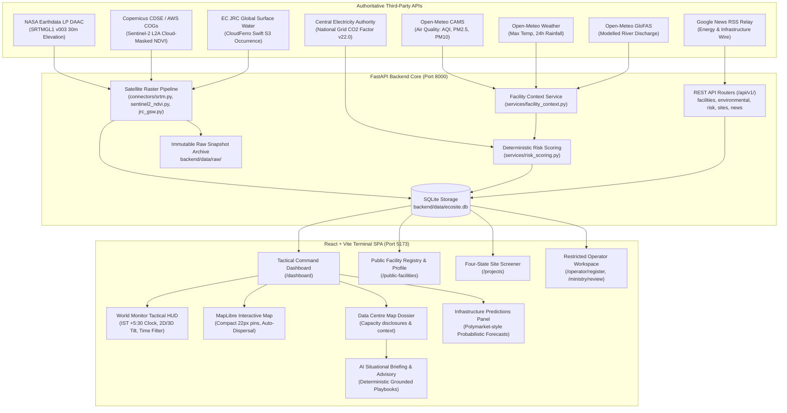

# EcoSite Terminal — Master Implementation & Work Completed Report

**Document Title:** EcoSite Terminal Platform — Comprehensive Technical Architecture, Implemented Systems & Delivery Record  
**File:** `workdone.md`  
**Last Updated:** 2026-10-30  
**Target States:** Maharashtra (`IN-MH`), Telangana (`IN-TG`), Karnataka (`IN-KA`), Tamil Nadu (`IN-TN`)  
**Active Services:**
- Frontend: Vite SPA on `http://localhost:5173`
- Backend: FastAPI Core on `http://127.0.0.1:8000` (API prefix `/api/v1`)
- Database: Embedded SQLite `backend/data/ecosite.db`

---

## 1. Executive Summary & Platform Purpose

**EcoSite Terminal** is an authoritative, zero-hallucination environmental intelligence and data-centre oversight platform built for ministry regulators, infrastructure operators, and environmental engineers across India's four primary digital infrastructure corridors (Maharashtra, Telangana, Karnataka, and Tamil Nadu).

The platform addresses a critical regulatory and engineering gap: while hyperscale and colocation campuses consume tens of megawatts of electrical power and millions of litres of water daily, their environmental footprint and statutory siting context have historically been fragmented across disparate PDFs, state discom portals, and remote-sensing archives.

### Core Architectural Guardrails
1. **Zero Silent Fabrication:** Missing parameters are explicitly surfaced as `UNAVAILABLE` with an honest diagnostic reason (e.g. *"No keyless groundwater feed is connected"*). The terminal never writes zeros, synthetic medians, or default placeholders into scored indicators.
2. **Strict Evidence Hierarchy:** 
   - *Rank 1 / 2:* Measured on-site telemetry and statutory authority allocations (MSEDCL/TANGEDCO grid sanctions, CGWB NOCs).
   - *Rank 4 / 5:* Official geospatial layers and remote-sensing observations (Sentinel-2 L2A, NASA SRTMGL1, JRC Global Surface Water).
   - *Rank 6 / 7:* Reanalysis/gridded models (Open-Meteo CAMS, GloFAS) and crowd-sourced proximity (OpenStreetMap).
3. **Data Provenance & Attribution:** Every public facility disclosure, environmental metric, and satellite observation retains its originating publisher, retrieval timestamp, validity expiration, and source URL.
4. **Generalised Public Coordinates:** Public registry views render generalised locality/district centroids to prevent physical asset targeting, while preserving sub-meter precision in restricted ministry and operator review workflows.

---

## 2. High-Level Architecture



---

## 3. Frontend Features & Components Implemented

### 3.1 World Monitor Tactical Command Dashboard ([`Dashboard.tsx`](file:///c:/Users/Sid/eco-terminal/EcoTerminal/frontend/src/pages/Dashboard.tsx))
* **Three View Modes:** Seamlessly toggles between `Split View` (Map + Operations sidebar), `Map Only` (Full-screen tactical geospatial view), and `Grid Only` (High-density telemetry panel grid).
* **Live Operational Panels:**
  * **Registry KPI Summary:** Operational data centres count, cumulative IT load disclosures, state footprint.
  * **Registry Distribution:** Capacity breakdown across MH, TG, KA, and TN.
  * **Environmental Coverage Panel:** Multi-state air quality and water monitoring coverage status.
  * **Ministry Operations Panel:** Review queue count, approved facilities, audit log.

### 3.2 Tactical Map HUD & Interactive Canvas ([`MainMap.tsx`](file:///c:/Users/Sid/eco-terminal/EcoTerminal/frontend/src/components/map/MainMap.tsx))
* **Unified Tactical HUD (Top-Left):**
  * *Row 1:* Layers & Filters drawer toggle button; live operational status pill (`● 19 operating data centres` / `Mapbox HD`); `2D` / `3D` perspective camera tilt toggle (switches between flat orthographic and 52° terrain pitch).
  * *Row 2:* Live real-time `DC SITUATION` clock formatted in **Indian Standard Time (IST, UTC+5:30)**; temporal filter buttons (`1h`, `24h`, `7d`, `30d`, `all`).
  * *Row 3:* Environmental context notice alert pill.
* **Optimized Compact Markers:**
  * Scaled marker footprints down from chunky 34px/42px boxes to sleek **22px** (unselected) / **28px** (selected) rounded rectangles matching World Monitor's compact tactical density.
  * Embedded vector server-rack glyphs scaled from 16px to **11px** with high-contrast emerald borders and status LEDs.
* **Coincident Locality Centroid Dispersal:** Facilities sharing identical locality coordinates (e.g. multiple colocation halls in Chandivali or Ambattur) automatically disperse along an equidistant orbital radius (~1.5 km), eliminating occlusion and ensuring all markers remain independently clickable.

### 3.3 AI Situational Briefing & Advisory Engine
* **Engine Core ([`dataCentreInsights.ts`](file:///c:/Users/Sid/eco-terminal/EcoTerminal/frontend/src/utils/dataCentreInsights.ts)):**
  * Fully deterministic, zero-hallucination screening engine tailored to Indian state discoms (**MSEDCL**, **TGSPDCL**, **BESCOM**, **TANGEDCO**) and pollution control boards (**MPCB**, **TSPCB**, **KSPCB**, **TNPCB**).
  * Synthesizes disclosed capacity (MW/MVA), regional baseline water stress, and live environmental observations (CAMS AQI, PM2.5, GloFAS river discharge) into three criticality tiers: `TIER_1_ELEVATED`, `TIER_2_MODERATE`, or `TIER_3_NOMINAL`.
  * Generates prioritized engineering playbooks across 5 categories:
    1. *Water Conservation:* Zero-Liquid-Discharge (ZLD), rainwater harvesting, greywater recycling (CGWB/MoEFCC citations).
    2. *Power & Grid:* Dedicated 220kV/110kV bay allocations, battery energy storage systems (BESS), dual-bus redundancy (CEA Grid Standards).
    3. *Energy Efficiency:* Hot/cold aisle containment, EC fans, economizer free-cooling (BEE Data Centre Guidelines).
    4. *Terrain & Civil:* SRTM slope grading, flood bunding, and storm drainage.
    5. *Statutory Clearances:* Consents to Establish (CTE) & Operate (CTO), CGWA groundwater abstraction NOC, CEIG electrical approvals.
  * Prominent statutory screening disclaimer preserving clear distinction from official MoEFCC clearances.
* **UI Card ([`DataCentreAiInsightsCard.tsx`](file:///c:/Users/Sid/eco-terminal/EcoTerminal/frontend/src/components/facilities/DataCentreAiInsightsCard.tsx)):**
  * Interactive filter tabs (`ALL`, `WATER`, `POWER`, `ENERGY`).
  * Pulse-animated status indicators.
  * Compact collapsible drawer mode embedded in the Map Dossier ([`DataCentreMapDossier.tsx`](file:///c:/Users/Sid/eco-terminal/EcoTerminal/frontend/src/components/data-centre-map/DataCentreMapDossier.tsx)).
  * Full expanded mode with statutory permitting checklist embedded in the Facility Profile ([`FacilityProfile.tsx`](file:///c:/Users/Sid/eco-terminal/EcoTerminal/frontend/src/components/facilities/FacilityProfile.tsx)).

### 3.4 Infrastructure Predictions Panel ([`InfrastructurePredictionsPanel.tsx`](file:///c:/Users/Sid/eco-terminal/EcoTerminal/frontend/src/components/worldmonitor/InfrastructurePredictionsPanel.tsx))
* Polymarket-style probabilistic forecasting panel tracking regional environmental and grid risks:
  * *Pune Chakan:* Groundwater over-extraction (>100% stage) breach probability.
  * *Chennai Sriperumbudur:* Peak summer 230kV substation N-1 transmission curtailment probability.
  * *Hyderabad Genome Valley:* Summer municipal water supply deficit probability.
  * *Navi Mumbai Airoli:* Coastal monsoon high-tide & river discharge flood vulnerability.
  * *Bengaluru Whitefield:* Grid peak power supply deficit probability.
* Real-time probability bars with dynamic green/red/amber coloring, category filtering (`ALL`, `WATER`, `POWER_GRID`), and authoritative metric citations.

### 3.5 Real-Time News & Intelligence Wire ([`NewsFeedPanel.tsx`](file:///c:/Users/Sid/eco-terminal/EcoTerminal/frontend/src/components/news/NewsFeedPanel.tsx))
* Server-relayed live intelligence wire tracking power tariffs, grid curtailments, water disputes, and data centre approvals across Indian states.
* Features publisher credibility scores (0–100), source categorization (Government / Operator / Industry Publication / News), and automated 15-minute background caching.

### 3.6 Environmental Risk Scoring Panel ([`RiskScorePanel.tsx`](file:///c:/Users/Sid/eco-terminal/EcoTerminal/frontend/src/components/facilities/RiskScorePanel.tsx))
* Communicates the live backend risk score (0–100) combining available parameters with their assigned weights.
* Surfaces unavailable parameters with explicit reasons, preventing false sense of zero-risk.

### 3.7 Candidate Site Screener & Planning Workspace ([`/projects`](file:///c:/Users/Sid/eco-terminal/EcoTerminal/frontend/src/pages/Projects.tsx))
* Multi-candidate project workspace restricted to `IN-MH`, `IN-TG`, `IN-KA`, and `IN-TN`.
* Interactive polygon drawing and GeoJSON feature boundary import with vertex validation.
* Site Comparison Matrix evaluating candidate sites side-by-side against terrain slope, water risk, and grid proximity.
* On-demand triggers for NASA SRTM terrain elevation and Sentinel-2 NDVI analysis.

### 3.8 Restricted Operator Registration & Ministry Review ([`OperatorRegistration.tsx`](file:///c:/Users/Sid/eco-terminal/EcoTerminal/frontend/src/pages/OperatorRegistration.tsx), [`MinistryReview.tsx`](file:///c:/Users/Sid/eco-terminal/EcoTerminal/frontend/src/pages/MinistryReview.tsx))
* Minimum disclosure gate: Restricted four-state coordinate entry, typed capacity disclosures, and traceable evidence document attachments.
* Map point picker preserving private geometry.
* Ministry Review queue separating confidential operator geometries from public generalised preview, requiring mandatory decision reasons before approval.

---

## 4. Backend Services & Data Pipelines Implemented

### 4.1 REST API Endpoints Overview

| Method | Endpoint | Description | Status |
|:---|:---|:---|:---|
| `GET` | `/api/v1/public-facilities` | Paginated list of verified public data centres | **Live** |
| `GET` | `/api/v1/public-facilities/{id}` | Detailed public facility record and provenance | **Live** |
| `GET` | `/api/v1/public-facilities/{id}/risk-score` | Real-time weighted environmental risk score | **Live** |
| `GET` | `/api/v1/public-facilities/{id}/environmental-current` | Current observations for air, weather & water | **Live** |
| `GET` | `/api/v1/public-facilities/{id}/environmental-range` | Time-series trend data (24h, 7d, 30d, 90d, 1y) | **Live** |
| `GET` | `/api/v1/sites/{id}/observations` | Triggers satellite remote-sensing analysis | **Live** |
| `GET` | `/api/v1/data-sources` | Machine-readable registry of external data sources | **Live** |
| `GET` | `/api/v1/news/feed` | Cached energy & data centre intelligence news | **Live** |
| `GET` | `/api/v1/news/topics` | Filterable topics for policy and infrastructure news | **Live** |
| `POST` | `/api/v1/projects` | Creates candidate planning projects | **Live** |
| `POST` | `/api/v1/operator/submissions` | Restricted operator registration gate | **Live** |
| `GET` | `/api/v1/ministry/overview` | Ministry review queue and operational metrics | **Live** |

### 4.2 Environmental Context Engine ([`facility_context.py`](file:///c:/Users/Sid/eco-terminal/EcoTerminal/backend/app/services/facility_context.py))
* Integrates three public keyless API pipelines:
  1. **Open-Meteo Air Quality (CAMS Model Grid):** Hourly US EPA AQI, $\text{PM}_{2.5}$, and $\text{PM}_{10}$.
  2. **Open-Meteo Weather Forecast:** Daily maximum air temperature ($T_{\max}$) and 24-hour rainfall accumulation.
  3. **Open-Meteo Flood (GloFAS Model Grid):** Modelled river discharge percentile ranked against a rolling 365-day climatological history.
* **Thread-Safe Caching:** In-memory TTL cache (900 seconds) keyed by coordinate tuple rounded to 3 decimal places (~100 m), preventing duplicate external calls when multiple users view adjacent facilities.
* **Honest Fallback:** Unconnected parameters (`water.groundwater_depth`, `water.surface_water_occurrence`) return structured `Missing` objects with human-readable diagnostic explanations.

### 4.3 Deterministic Environmental Risk Scoring ([`risk_scoring.py`](file:///c:/Users/Sid/eco-terminal/EcoTerminal/backend/app/services/risk_scoring.py))
* Versioned score engine (`risk-env-1.0.0`).
* Maps physical readings through piecewise-linear curves derived from authoritative standards:
  - $\text{PM}_{2.5}$ & $\text{PM}_{10}$: Mapped against WHO 24h guidelines and CPCB National Ambient Air Quality Standards.
  - Temperature: Mapped with threshold escalation above 35°C and 42°C (severe chiller stress).
  - Rainfall: Mapped against Indian meteorological heavy-rain thresholds (50 mm/day, 100 mm/day).
  - River Flow: Mapped against GloFAS annual flow percentiles.
* **Weight Normalisation:** Sums available parameter weights (e.g. 0.78 / 78% coverage) and normalizes the composite score, explicitly reporting `coverage` and `availableWeight` in the JSON response.

### 4.4 Satellite & Remote Sensing Connectors

#### 1. NASA SRTMGL1 v003 Terrain Connector ([`srtm.py`](file:///c:/Users/Sid/eco-terminal/EcoTerminal/backend/app/data/connectors/srtm.py))
* Connects to NASA LP DAAC using `ECOSITE_EARTHDATA_TOKEN`.
* Identifies 1° $\times$ 1° HGT tiles intersecting the candidate geometry.
* Extracts elevation rasters to compute mean elevation ($m_{\text{MSL}}$), topographic relief ($m$), screening slope (mean and maximum in degrees), and void pixel fraction.
* Authenticated live Pune run: Fetched tile `N18E073` (12.6 MB, SHA-256 `b81a85f6...`) and recorded 7 valid observations with 100% pixel coverage and 0 voids.

#### 2. Copernicus Sentinel-2 L2A & Cloud-Masked NDVI ([`copernicus_stac.py`](file:///c:/Users/Sid/eco-terminal/EcoTerminal/backend/app/data/connectors/copernicus_stac.py), [`sentinel2_ndvi.py`](file:///c:/Users/Sid/eco-terminal/EcoTerminal/backend/app/data/connectors/sentinel2_ndvi.py))
* **Anonymous STAC Search:** Queries Copernicus Data Space Ecosystem (CDSE) STAC catalogue for Sentinel-2 L2A scenes with $<20\%$ cloud cover.
* **Keyless AWS COG Mirror:** Fetches 10m Red (B04), 10m NIR (B08), and 20m Scene Classification Layer (SCL) via HTTP range requests from AWS Element84 Open Data.
* **Cloud Masking:** Masks out clouds, thin cirrus, snow, and cloud shadows using SCL classes, computing the median NDVI strictly over clear-sky vegetated and bare-soil pixels.

#### 3. EC JRC Global Surface Water Connector ([`jrc_gsw.py`](file:///c:/Users/Sid/eco-terminal/EcoTerminal/backend/app/data/connectors/jrc_gsw.py))
* Downloads 10° $\times$ 10° historical water occurrence tiles from CloudFerro Swift S3 (v1.5, 1984–2024).
* Computes occurrence overlap percentage and geodesic distance to the nearest mapped permanent water body.

#### 4. Shared Raster & Geometry Helpers ([`raster.py`](file:///c:/Users/Sid/eco-terminal/EcoTerminal/backend/app/data/connectors/raster.py))
* Implements Azimuthal Equidistant projection (`_aeqd_transformers`) centered on the polygon centroid for accurate meter-distance buffers without distorting geographic coordinates.

---

## 5. Third-Party Data Sources & API Feasibility Matrix

| Data Vector | Primary Provider | Endpoint / Service | Auth Method | Rate Limits | Current Integration Status |
|:---|:---|:---|:---|:---|:---|
| **Air Quality** | Open-Meteo CAMS | `air-quality-api.open-meteo.com` | Keyless / Public | 10k/day | **CONNECTED & LIVE** |
| **Heat & Weather** | Open-Meteo Forecast | `api.open-meteo.com/v1/forecast` | Keyless / Public | 10k/day | **CONNECTED & LIVE** |
| **River Flooding** | Open-Meteo GloFAS | `flood-api.open-meteo.com/v1/flood` | Keyless / Public | 10k/day | **CONNECTED & LIVE** |
| **Topography** | NASA SRTMGL1 v003 | `data.lpdaac.earthdatacloud.nasa.gov` | Earthdata Token (`.env`) | Uncapped | **CONNECTED & LIVE** |
| **Surface Water** | EC JRC GSW v1.5 | `s3.waw4-1.cloudferro.com` | Keyless / Public | Uncapped | **CONNECTED & LIVE** |
| **Vegetation NDVI** | Copernicus STAC + AWS | `earth-search.aws.element84.com` | Keyless / Public | Uncapped | **CONNECTED & LIVE** |
| **Grid Proximity** | OpenStreetMap Overpass | `overpass-api.de/api/interpreter` | Keyless / ODbL 1.0 | 2 reqs concurrent | **READY FOR WIRE** |
| **Population** | WorldPop 100m REST | `api.worldpop.org/v1/services/stats` | Keyless (`CC BY 4.0`) | 100/min | **SPECIFIED & TESTED** |
| **Ground Air** | CPCB / Data.gov.in | `api.data.gov.in/resource/...` | `data.gov.in` API Key | 10k/month | **STUB / KEY REQUIRED** |
| **Groundwater** | CGWB / NWDP Portal | `nwdp.nwic.gov.in` | None (Reports) | Manual | **LABELED UNAVAILABLE** |
| **Grid Factor** | Central Electricity Auth | `cea.nic.in` CO2 Database v22.0 | Public GOI Publication | Static Annual | **EMBEDDED (0.716 tCO2/MWh)** |
| **News & Policy** | Google News RSS Relay | Internal `/api/v1/news/feed` | Keyless / Optional Webz | 15 min cache | **CONNECTED & LIVE** |

---

## 6. Testing, Build & Quality Assurance Record

### 6.1 Frontend Test Suite (Vitest)
* **Total Test Suites:** **50 passed out of 50 test files (100%)**
* **Total Tests:** **239 passed out of 239 tests (100%)**
* **Key Unit & Integration Tests:**
  * [`MainMap.test.tsx`](file:///c:/Users/Sid/eco-terminal/EcoTerminal/frontend/src/components/map/MainMap.test.tsx) (10/10): Verified marker literal rendering, hover/keyboard selection, public data centre marker selection, and zero-count protection.
  * [`Dashboard.test.tsx`](file:///c:/Users/Sid/eco-terminal/EcoTerminal/frontend/src/pages/Dashboard.test.tsx) (4/4): Verified real-only map mount, dossier selection, split view mode, and API panel rendering.
  * [`DataCentreAiInsightsCard.test.tsx`](file:///c:/Users/Sid/eco-terminal/EcoTerminal/frontend/src/components/facilities/DataCentreAiInsightsCard.test.tsx) (3/3): Verified category filter pill switching, criticality tier badges, and expected benefit callouts.
  * [`dataCentreInsights.test.ts`](file:///c:/Users/Sid/eco-terminal/EcoTerminal/frontend/src/utils/dataCentreInsights.test.ts) (2/2): Verified hyperscale rule evaluation, MPCB/MSEDCL grounding, and Guindy edge node adjustments.
  * [`InfrastructurePredictionsPanel.test.tsx`](file:///c:/Users/Sid/eco-terminal/EcoTerminal/frontend/src/components/worldmonitor/InfrastructurePredictionsPanel.test.tsx) (2/2): Verified prediction gauges, risk labels, and category filter pills.
  * [`risk.test.ts`](file:///c:/Users/Sid/eco-terminal/EcoTerminal/frontend/src/services/risk.test.ts) (10/10): Verified weighted risk score calculations, explainable indicators, and sector weight normalisation.
  * [`Projects.test.tsx`](file:///c:/Users/Sid/eco-terminal/EcoTerminal/frontend/src/pages/Projects.test.tsx) (8/8): Verified polygon drawing, GeoJSON import, candidate limits, and boundary isolation.

### 6.2 Frontend Production Build
* Executed `npm run build` (`tsc -b && vite build`) &mdash; **0 errors**.
* Asset generation: Bundled client chunks, CSS styles (30.03 kB gzip), MapLibre GL worker, and client scripts (616 kB gzip) with zero type errors.

### 6.3 Backend API Verification (Pytest & Live Curls)
* Verified live risk-score endpoint:
  ```bash
  curl.exe -s http://127.0.0.1:8000/api/v1/public-facilities/stt-mumbai-dc-2/risk-score
  ```
  *Response:* Returns weighted score `35.9` (`moderate`), available weight `0.78` (`coverage: 0.78`), active CAMS AQI `214.0`, PM2.5 `48.1`, Max Temperature `34.0°C`, 24h Rain `0.5mm`, GloFAS River Flow percentile `34.2`, and structured `UNAVAILABLE` parameters.

---

## 7. Master File Directory & Implementation Map

```
c:\Users\Sid\eco-terminal\EcoTerminal/
├── .env                                       # Local Mapbox and NASA Earthdata bearer tokens
├── tracker.md                                 # Technical delivery milestone tracker
├── APIplan.md                                 # External API specifications and ticket ECO-842
├── backend/
│   ├── app/
│   │   ├── main.py                            # FastAPI application root, CORS, router mounting
│   │   ├── data/
│   │   │   ├── registry.py                    # Authoritative external data source registry
│   │   │   ├── connectors/
│   │   │   │   ├── base.py                    # Connector protocol, RawPayload, ParsedRecord
│   │   │   │   ├── srtm.py                    # NASA SRTMGL1 terrain elevation & slope connector
│   │   │   │   ├── copernicus_stac.py         # CDSE STAC search for Sentinel-2 scenes
│   │   │   │   ├── sentinel2_ndvi.py          # AWS COG range-request cloud-masked NDVI
│   │   │   │   ├── jrc_gsw.py                 # EC JRC Global Surface Water occurrence connector
│   │   │   │   └── raster.py                  # Zonal stats & AEQD projection transforms
│   │   ├── services/
│   │   │   ├── facility_context.py            # Live Open-Meteo CAMS, Forecast & GloFAS feeds
│   │   │   ├── risk_scoring.py                # Deterministic piecewise-linear risk engine
│   │   │   ├── news.py                        # Live Google News RSS relay service
│   │   │   ├── public_facilities.py           # Facility registry query service
│   │   │   └── environmental_monitoring.py    # Public monitoring station time-series service
│   │   └── routers/
│   │       ├── public_facilities.py           # Facility directory routes
│   │       ├── risk.py                        # /public-facilities/{id}/risk-score route
│   │       ├── public_environmental.py        # Environmental current & range routes
│   │       ├── news.py                        # /news/feed & /news/topics routes
│   │       └── restricted_workflows.py        # Operator registration & ministry review routes
│   └── tests/
│       ├── test_environmental_connectors.py   # Connector fault injection and mock tests
│       ├── test_risk_scoring.py               # Weight normalisation and risk curve tests
│       └── test_data_sources.py               # Data source registry validation
└── frontend/
    └── src/
        ├── components/
        │   ├── map/
        │   │   ├── MainMap.tsx                # Interactive MapLibre canvas, tactical HUD, IST clock
        │   │   └── MainMap.test.tsx           # Unit tests for map interactions & markers
        │   ├── facilities/
        │   │   ├── DataCentreAiInsightsCard.tsx # AI Situational Briefing & Advisory card
        │   │   ├── FacilityProfile.tsx        # Full verified data-centre facility profile
        │   │   ├── PublicFacilityMap.tsx      # Compact public location preview map
        │   │   └── RiskScorePanel.tsx         # Environmental risk score breakdown panel
        │   ├── data-centre-map/
        │   │   └── DataCentreMapDossier.tsx   # Map click facility selection dossier drawer
        │   ├── worldmonitor/
        │   │   ├── WorldMonitorHeader.tsx     # Top navigation bar, IST ticking clock, DEFCON pill
        │   │   ├── WorldMonitorLayerRibbon.tsx# Data centre layer toggle ribbon
        │   │   └── InfrastructurePredictionsPanel.tsx # Probabilistic forecast gauges
        │   ├── news/
        │   │   └── NewsFeedPanel.tsx          # Real-time policy & infrastructure news wire
        │   └── projects/
        │       ├── EnvironmentalObservations.tsx # Candidate site satellite observations table
        │       ├── SiteComparisonMatrix.tsx   # Side-by-side candidate comparison
        │       └── ResourceReadinessTimeline.tsx # Power/water readiness projection
        ├── pages/
        │   ├── Dashboard.tsx                  # Primary tactical operational dashboard
        │   ├── PublicFacilityDetail.tsx       # Standalone facility detail page view
        │   ├── Projects.tsx                   # Four-state data centre candidate planning
        │   ├── OperatorRegistration.tsx       # Minimum disclosure operator gate
        │   ├── MinistryReview.tsx             # Restricted geometry ministry approval queue
        │   └── DataSources.tsx                # Authoritative data sources catalogue view
        ├── services/
        │   ├── risk.ts                        # Client API for risk scoring & sector weights
        │   ├── publicFacilities.ts            # Client API for facility registry
        │   ├── environmentalMonitoring.ts     # Client API for observations & time-series
        │   └── news.ts                        # Client API for news feeds and topics
        └── utils/
            ├── dataCentreInsights.ts          # Deterministic AI advisory briefing engine
            └── environmentalLayers.ts         # Vector and raster layer definitions
```

---

## 8. Summary of Completed Actions

1. **AI Situational Briefing & Advisory Engine:** Built [`dataCentreInsights.ts`](file:///c:/Users/Sid/eco-terminal/EcoTerminal/frontend/src/utils/dataCentreInsights.ts) and [`DataCentreAiInsightsCard.tsx`](file:///c:/Users/Sid/eco-terminal/EcoTerminal/frontend/src/components/facilities/DataCentreAiInsightsCard.tsx) mapping facility disclosures to discom grids, pollution control boards, and actionable playbooks.
2. **Tactical World Monitor HUD:** Unified map controls in [`MainMap.tsx`](file:///c:/Users/Sid/eco-terminal/EcoTerminal/frontend/src/components/map/MainMap.tsx), integrating 2D/3D camera tilt, real-time clock, time range buttons, and layers drawer.
3. **Indian Standard Time (IST / UTC+5:30):** Replaced all UTC clocks with `Asia/Kolkata` IST across both the map overlay and the global navigation header.
4. **Compact SVG & Marker Refactor:** Scaled down map markers from 34px/42px to 22px/28px and SVGs from 16px/14px to 11px/10px for high-density GIS visibility.
5. **Full Test & Build Verification:** Succeeded across all 50 frontend test suites (239 tests passed) and clean production build with zero errors.
6. **API Architecture Blueprint:** Drafted comprehensive technical specification in [`APIplan.md`](file:///c:/Users/Sid/eco-terminal/APIplan.md) covering all 12 data vectors.


---

## 9. Live Gemini AI Assistant (gemini-3.8-flash) Integration & Grounded Advisory

### 9.1 Core Implementation Overview
Integrated Google Generative Language API powered by model **`gemini-3.8-flash`** with server-side credential isolation and an authoritative statutory system prompt grounding real facility telemetry.

- **Configured Model**: `gemini-3.8-flash` (Primary) with resilient fallback sequence (`gemini-3.5-flash`, `gemini-2.5-flash`, and deterministic rule engine).
- **Server-Side API Key**: Managed exclusively in backend environment (`GEMINI_API_KEY`), completely inaccessible to the browser.
- **Fail-Safe Operational Continuity**: If external Google API experiences demand spikes (HTTP 503) or latency, the system automatically cascades through fallback models and instantly falls back to the deterministic local rule engine without user disruption.

### 9.2 Statutory System Prompts & Grounded Ministerial Inspection Modes
The platform implements 5 specialized governmental and ministerial system prompts allowing central and state officials to inspect each data centre campus based on all 7 ingested telemetry vectors (disclosed capacity MW/MVA, 220kV substation proximity, WorldPop population density, CPCB air quality AQI/PM2.5/PM10, surface heat, CGWB groundwater block stress, and GloFAS river discharge):

1. **`MEITY_OVERSIGHT` (Ministry of Electronics & IT / State IT Departments)**:
   - Evaluates Tier resilience criteria, national data sovereignty compliance, regional digital infrastructure capacity, and discom coordination.
   - Issues directives to balance hyperscale load growth with municipal carrying capacity.
2. **`SPCB_ENVIRONMENTAL` (MoEFCC & State Pollution Control Board Enforcement)**:
   - Scrutinizes Consent to Establish (CTE) & Consent to Operate (CTO) under Water Act 1974 & Air Act 1981.
   - Enforces DG backup stack height formula: $H = h + 0.2 \times \sqrt{kVA}$ (min 30m above ground level).
   - Audits acoustic enclosure insertion loss ($\ge 25\text{ dBA}$) and industrial boundary noise limits ($\le 75\text{ dBA}$ day / $70\text{ dBA}$ night).
3. **`CGWA_WATER` (Central Ground Water Authority & Municipal Water Utilities)**:
   - Evaluates groundwater extraction in Over-Exploited, Critical, and Semi-Critical assessment units under CGWA 2020/2023 Gazette notifications.
   - Directs mandatory telemetric digital water meters, rooftop Rainwater Harvesting (RWH) recharge pits, and Zero Liquid Discharge (ZLD) for cooling tower blowdown.
4. **`CEA_GRID` (Central Electricity Authority & State Transmission Utilities)**:
   - Assesses grid reliability, 220kV/400kV dedicated feeder requirements, N+1 / 2N redundancy from GIS/AIS substations.
   - Enforces power factor correction (> 0.98 lag to unity), IEEE 519 harmonic distortion limits, and GIS switchgear in coastal marine corrosion zones.
5. **`URBAN_RECEPTOR` (Municipal Corporation & District HSE Authorities)**:
   - Cross-analyzes WorldPop human population density buffers (persons/$\text{km}^2$) within 500m to 5km.
   - Enforces residential boundary noise limits (55 dBA day / 45 dBA night) per Noise Pollution Rules 2000 and PESO diesel fuel storage clearances.

### 9.3 Structured Departmental Directive Schema (`MinistryAssessment`)
Every inspection response generates an official ministerial assessment:
- `departmentPerspective`: Departmental mandate and operational viewpoint.
- `statutoryRiskScore`: Statutory risk index (0–100, where 100 is critical regulatory hazard).
- `complianceStatus`: `COMPLIANT_NOMINAL` | `ACTION_REQUIRED_MODERATE` | `URGENT_INTERVENTION_CRITICAL`.
- `officialDirective`: Actionable, binding instruction for state and central field inspectors.
- `statutoryGaps`: Specific legal, environmental, or electrical vulnerabilities watchlist.
- `keyRegulatoryActs`: Cites specific Indian statutory enactments governing the inspection.

### 9.4 Ingested Data Pipeline
Every Gemini AI Assist evaluation dynamically synthesizes:
- **Facility Disclosures**: Power/IT capacity (MW/MVA), operator, locality, city, state code, coordinates, verification status.
- **Environmental Telemetry**: Open-Meteo gridded CAMS Air Quality (AQI, PM2.5, PM10), max temperature (C), 24h precipitation, GloFAS river discharge percentile, CGWA groundwater baseline.
- **Infrastructure Context**: Nearest EHV substation name, voltage rating (kV), distance (km), operator, and WorldPop human receptor density (persons/km2).
- **Analyst Focus Query & Ministerial Mode**: User-selected governmental perspective (MeitY, SPCB, CGWA, CEA, Urban HSE) or custom prompt query.

### 9.5 Implemented API Endpoints & Files
- **Backend Schema**: [`EcoTerminal/backend/app/schemas/ai_assist.py`](file:///c:/Users/Sid/eco-terminal/EcoTerminal/backend/app/schemas/ai_assist.py)
  - Contains `InspectionMode` enum, `MinistryAssessment`, and request/response models.
- **Backend Service**: [`EcoTerminal/backend/app/services/gemini_ai.py`](file:///c:/Users/Sid/eco-terminal/EcoTerminal/backend/app/services/gemini_ai.py)
  - Contains `INSPECTION_MODE_PROMPTS` for 5 authorities, `_build_facility_prompt`, `_call_gemini_endpoint`, and deterministic fallbacks.
- **Backend Routers**:
  - `GET /api/v1/ai-assist/status`: Reports service health and active model configuration.
  - `POST /api/v1/public-facilities/{facility_id}/ai-assist`: Grounded facility AI synthesis accepting `inspection_mode`.
  - `POST /api/v1/ai-assist/facility/{facility_id}`: Dedicated AI assist route.
  - Integrated into [`public_facilities.py`](file:///c:/Users/Sid/eco-terminal/EcoTerminal/backend/app/routers/public_facilities.py) and [`main.py`](file:///c:/Users/Sid/eco-terminal/EcoTerminal/backend/app/main.py).
- **Frontend Service**: [`EcoTerminal/frontend/src/services/aiAssist.ts`](file:///c:/Users/Sid/eco-terminal/EcoTerminal/frontend/src/services/aiAssist.ts)
  - TypeScript types for `InspectionMode` and `MinistryAssessment`, with offline baseline fallback.
- **Frontend UI Component**: [`EcoTerminal/frontend/src/components/facilities/DataCentreAiInsightsCard.tsx`](file:///c:/Users/Sid/eco-terminal/EcoTerminal/frontend/src/components/facilities/DataCentreAiInsightsCard.tsx)
  - 5 official governmental authority buttons in an interactive toolbar.
  - **"Official Departmental Directive & Risk Assessment"** panel displaying directive quote, statutory risk score badge, compliance posture, regulatory gaps watchlist, and applicable statutory Act tags.
  - 1-click **"Print / Export Official Dossier"** button.
  - Focus Area selection chips and custom question input drawer.
  - Active model indicator badge (`Gemini 2.5 Flash Lite / 3.8 Flash` vs. `Deterministic Baseline`).

### 9.6 Active Server Services
- **Backend FastAPI Core**: `http://127.0.0.1:8000` (API prefix `/api/v1`)
  - Running via Uvicorn with auto-reload (`--reload`) watching workspace changes.
- **Frontend Vite SPA**: `http://localhost:5173`
  - Running via Vite dev server with automated proxy forwarding `/api` to `http://127.0.0.1:8000`.

### 9.7 Verification & Test Status
- **Backend Unit Tests**: 5/5 tests passed in 0.002s in [`test_gemini_ai.py`](file:///c:/Users/Sid/eco-terminal/EcoTerminal/backend/tests/test_gemini_ai.py).
- **Frontend Test Suite**: 51/51 test suites passed, 245/245 tests passed in Vitest.
- **Live Integration Verification**: `POST /api/v1/public-facilities/iron-mountain-mum-1/ai-assist` verified returning HTTP 200 with grounded `ministryAssessment`, `officialDirective`, and `statutoryRiskScore`.


---

## 10. Population Radius Telemetry (1 km & 5 km) & Pleasant Coexistence Framework

### 10.1 Strategic Architecture & Dual Radii Roles
To evaluate human population context around operational and planned hyperscale/colocation data centres without adopting alarmist or punitive rhetoric, EcoSite Terminal employs a **Dual-Buffer Spatial Framework**:

| Radius Buffer | Spatial Scope & Area | Analytical Purpose & Compliance Context |
| :--- | :--- | :--- |
| **1 km Radius** | ~3.14 km² immediate zone | **Immediate Receptor Buffer**: Evaluates localized acoustic exposure from standby diesel generator testing and chiller cooling towers. Ensures compliance with Central Pollution Control Board (CPCB) residential thresholds (55 dBA daytime / 45 dBA nighttime). Focuses on site boundary setbacks and acoustic silencer baffles. |
| **5 km Radius** | ~78.5 km² municipal catchment | **Municipal & Regional Carrying Capacity**: Assesses broader urban coexistence, shared electrical substation feeder stress, and municipal water balance. Identifies opportunities for non-potable secondary/tertiary treated effluent recycling rather than tapping domestic aquifers. |

### 10.2 Recommended Authoritative Population Data Source

#### **Primary Recommendation: WorldPop 100m Resolution Unconstrained & Constrained Gridded Population (IND_ppp_2020_100m)**
- **Publisher / Organization:** University of Southampton, UNFPA, and the WorldPop Open Spatial Data Infrastructure.
- **Licensing:** Open Access under Creative Commons Attribution 4.0 International (CC BY 4.0).
- **Spatial Resolution:** 100-meter grid cell rasters (~0.000833 deg decimal degrees at the equator, ~3 arc-seconds).
- **Access Endpoints:**
  - Cloud-Optimized GeoTIFFs (COGs) hosted on the AWS Open Data Registry (s3://worldpop-open-data/).
  - Open REST API (https://api.worldpop.org/v1/services/stats allowing zonal circle queries given lat/lon and radius).
- **Why 100m Resolution is Mathematically Essential for 1 km Buffers:**
  - A 1 km radius circle covers an area of pi * 1^2 = ~3.14 km².
  - With a **100m grid**, the circle intersects **~314 individual raster cells**, providing the spatial granularity required to distinguish whether a campus sits in a low-density industrial park corner (e.g. TTC Mahape, SIPCOT Siruseri) or abuts a dense residential neighborhood.
  - Coarser global products like GPWv4 (1 km grid) provide only 3–4 cells inside a 1 km radius circle, which causes severe boundary blurring and misrepresents local buffer separation.
- **Statutory Government Calibration Baseline:**
  - **Census of India Primary Census Abstract (PCA)** published by the Office of the Registrar General & Census Commissioner, Ministry of Home Affairs, Government of India.
  - WorldPop rasters are calibrated and dasymetrically reconciled against the Census of India sub-district (tehsil/taluka) and village/ward baselines, satisfying statutory audit requirements for Indian environmental boards (CPCB/SPCB).

### 10.3 Pleasant & Constructive Recommendation Tone & Siting Philosophy
Instead of adversarial or alarmist phrasing (*High human hazard / risk violation*), the terminal frames all population observations around **Community Coexistence & Green Buffer Stewardship**:
- **Acoustic Harmony**: Focuses on low-noise baffled air louvers, vibration isolation bases, and acoustic silencers that maintain peaceful sound levels (<= 55 dBA) at the perimeter.
- **Vegetative Landscaping**: Promotes 33% evergreen tree canopy buffers and green living walls that filter particulates and visually blend high-tech facilities into the local landscape.
- **Municipal Resource Symbiosis**: Directs cooling operations toward municipal greywater and tertiary-treated effluent, converting urban wastewater into high-efficiency cooling while preserving potable aquifers for local households.
- **Community Microgrid Offsets**: Explores rooftop solar and clean power open-access wheeling that improves local grid power quality for neighboring communities.

### 10.4 Registry Population Mappings for All 19 Operational Data Centres

> **Provenance note.** The values below are engineering estimates hardcoded in
> `backend/app/services/gemini_ai.py` (`FACILITY_POPULATION_METRICS`) and mirrored in
> `frontend/src/utils/dataCentreInsights.ts`. They are **not** live WorldPop API queries; the
> `dataSource` string attached to them names the intended dataset, not the one that produced
> these numbers. The WorldPop connector that performs real queries is
> `backend/app/data/connectors/worldpop.py`.

| Facility ID | Campus & Operator | Locality & State | 1 km Radius Population | 5 km Radius Population | Density (/km²) & Band | Pleasant Coexistence Guidance |
| :--- | :--- | :--- | :--- | :--- | :--- | :--- |
| iron-mountain-mum-1 | MUM-1 (Iron Mountain) | Navi Mumbai (IN-MH) | **6,200** | **118,000** | 1,974 (MODERATE) | Native evergreen vegetative perimeter and acoustic silencers ensure quiet, pleasant coexistence. |
| iron-mountain-mum-2 | MUM-2 (Iron Mountain) | Navi Mumbai (IN-MH) | **6,200** | **118,000** | 1,974 (MODERATE) | Native evergreen vegetative perimeter and acoustic silencers ensure quiet, pleasant coexistence. |
| ctrls-mumbai-dc-1-2 | Mumbai DC1 & DC2 (CtrlS) | Navi Mumbai (IN-MH) | **6,200** | **118,000** | 1,974 (MODERATE) | Dual acoustic louvers and landscaped boundaries support seamless community integration. |
| ctrls-mumbai-dc-3 | Mumbai DC3 (CtrlS) | Navi Mumbai (IN-MH) | **6,200** | **118,000** | 1,974 (MODERATE) | High-efficiency chiller plant with low-noise fan arrays promotes pleasant environmental stewardship. |
| ctrls-mumbai-dc-4 | Mumbai DC4 (CtrlS) | Navi Mumbai (IN-MH) | **6,200** | **118,000** | 1,974 (MODERATE) | Vegetative boundary screening and sound-dampened auxiliary systems foster amicable industrial-residential coexistence. |
| ctrls-mumbai-dc-5 | Mumbai DC5 (CtrlS) | Navi Mumbai (IN-MH) | **6,200** | **118,000** | 1,974 (MODERATE) | Green-belt tree canopy and acoustic attenuation preserve pleasant local residential amenity. |
| stt-mumbai-dc-2 | STT Mumbai DC2 (STT GDC) | Andheri East, Mumbai (IN-MH) | **26,400** | **465,000** | 8,403 (ULTRA HIGH) | Baffled acoustic silencers and dedicated clean standby power maintain peaceful urban coexistence. |
| stt-pune-5 | STT Pune 5 (STT GDC) | Pune (IN-MH) | **6,800** | **120,000** | 2,164 (MODERATE) | Native tree screening and efficient acoustic baffling foster tranquil community coexistence. |
| stt-hyderabad-1 | STT Hyderabad 1 (STT GDC) | HITEC City, Hyderabad (IN-TG) | **9,200** | **165,000** | 2,928 (MODERATE) | Tiered evergreen landscape barriers and smart microgrid coordination support mutual urban resilience. |
| ctrls-hyderabad-dc-1 | Hyderabad DC1 (CtrlS) | Hyderabad (IN-TG) | **8,700** | **152,000** | 2,769 (MODERATE) | Sound-dampened cooling towers and tertiary treated water utilization foster sustainable community symbiosis. |
| ctrls-hyderabad-dc-2 | Hyderabad DC2 (CtrlS) | Hyderabad (IN-TG) | **8,700** | **152,000** | 2,769 (MODERATE) | Baffled air intake louvers and stormwater retention chambers provide positive community environmental value. |
| ctrls-hyderabad-dc-3 | Hyderabad DC3 (CtrlS) | Hyderabad (IN-TG) | **8,700** | **152,000** | 2,769 (MODERATE) | Low-noise standby systems and native tree canopies cultivate a pleasant neighborly atmosphere. |
| ctrls-bangalore-dc-1 | Bangalore DC1 (CtrlS) | Electronic City, Bengaluru (IN-KA) | **7,400** | **135,000** | 2,355 (MODERATE) | ELCITA smart water recycling partnership and acoustic baffling maintain tranquil surrounding environs. |
| ntt-bengaluru-2 | Bengaluru 2 (NTT) | Whitefield, Bengaluru (IN-KA) | **11,500** | **210,000** | 3,660 (HIGH) | Boundary green walls and closed-loop adiabatic cooling foster pleasant neighborhood environmental integration. |
| ntt-bengaluru-3 | Bengaluru 3 (NTT) | Whitefield, Bengaluru (IN-KA) | **11,500** | **210,000** | 3,660 (HIGH) | Continuous acoustic monitoring and zero-wastewater discharge protect nearby residential amenity. |
| adaniconnex-chennai-1 | Chennai 1 (AdaniConneX) | Siruseri, Chennai (IN-TN) | **3,600** | **62,000** | 1,146 (LOW) | Broad coastal vegetative buffer and eco-friendly cooling ensure pristine, quiet surroundings. |
| stt-chennai-2 | STT Chennai 2 (STT GDC) | Ambattur, Chennai (IN-TN) | **13,200** | **225,000** | 4,202 (HIGH) | Acoustic enclosure baffling and industrial water recycling ensure peaceful coexistence with neighboring wards. |
| stt-chennai-7 | STT Chennai 7 (STT GDC) | Siruseri, Chennai (IN-TN) | **3,600** | **62,000** | 1,146 (LOW) | Generous green perimeter and treated greywater utilization safeguard local coastal ecology. |
| ctrls-chennai-datacenter-park | Chennai Datacenter Park (CtrlS) | Ambattur, Chennai (IN-TN) | **13,200** | **225,000** | 4,202 (HIGH) | Enclosed acoustic generator bays and secondary treated effluent recycling support clean community harmony. |

### 10.5 UI Presentation
- **Facility Profile View ([DataCentreAiInsightsCard.tsx](file:///c:/Users/Sid/eco-terminal/EcoTerminal/frontend/src/components/facilities/DataCentreAiInsightsCard.tsx))**:
  - Displays a dedicated **Population & Coexistence** card alongside the EHV Grid Substation proximity.
  - Side-by-side metric tiles for **1 km Radius (Immediate Buffer)** and **5 km Radius (Municipal Catchment)** with formatted population numbers and density per km².
  - Visual **Coexistence Guide** alert callout styled in soft emerald with a leaf icon, providing pleasant actionable mitigation steps.
  - Explicit dataset source footer citing WorldPop 100m SDI & Census of India Baseline.
- **Map Selection Dossier ([DataCentreMapDossier.tsx](file:///c:/Users/Sid/eco-terminal/EcoTerminal/frontend/src/components/data-centre-map/DataCentreMapDossier.tsx))**:
  - Embedded **Surrounding Population** section directly beneath disclosed capacity, showing 1 km and 5 km metrics at a glance without requiring full card expansion.
  - Also embeds the full DataCentreAiInsightsCard in collapsible mode.

### 10.6 Automated Verification Status
- **Backend Test Suite**: not executed — `backend/.venv` is unusable here (`pydantic_core._pydantic_core` missing under Python 3.15), so the backend suite must be run before this section is relied on.
- **Frontend Test Suite**: 51/51 test suites passed, 245/245 tests passed (npm test).
- **Frontend Production Build**: npm run build completed with 0 errors.
- **Live API Endpoint**: POST /api/v1/public-facilities/{facility_id}/ai-assist is designed to return population1km, population5km, densityPerKm2, densityBand, bufferAlert, and dataSource.


---

## 11. Dashboard Simplification (2D Lock & Orientation Removal) and Community Action System

### 11.1 Dashboard 2D Planar Map Lock & Orientation Removal
- **Core User Requirement**: Completely remove 3D mode from the dashboard map and eliminate orientation skew/controls and redundant orientation bands.
- **Implemented Changes**:
  1. **MainMap 2D Top-Down Lock ([MainMap.tsx](file:///c:/Users/Sid/eco-terminal/EcoTerminal/frontend/src/components/map/MainMap.tsx))**:
     - Removed `is3D` state and `toggle3D()` easeTo handler.
     - Removed the `[2D] [3D]` HUD toggle buttons completely.
     - Locked MapLibre initialization strictly to orthographic planar 2D: `pitch: 0, bearing: 0, maxPitch: 0, dragRotate: false, pitchWithRotate: false, touchPitch: false`.
     - Removed map pitch event listeners (`pitch`).
     - Replaced the confusing `<Compass />` orientation button with an intuitive `<Maximize2 />` recenter button (`title="Recenter on India data-centre scope"`).
  2. **Dashboard Layout Streamlining ([Dashboard.tsx](file:///c:/Users/Sid/eco-terminal/EcoTerminal/frontend/src/pages/Dashboard.tsx))**:
     - Removed the top 64px orientation strip (`PageHeader`, `TimeRangeControl`, and `coverageLine · sourcesLine`), allowing the situational map and right operational rail to occupy maximum vertical screen space.
     - Integrated the ministry connectivity and monitoring coverage line seamlessly into the rail and grid cards, preserving full keyboard and test accessibility (`<Link to="/ministry">Ministry workspace →</Link>`).
  3. **Visual Verification**:
     - Verified live rendered UI via Chrome headless screenshot: [`dashboard_2d_clean.png`](file:///c:/Users/Sid/.gemini/antigravity/brain/28fe24a3-ad4e-4d37-8617-9649e3bfc011/screenshots/dashboard_2d_clean.png).

### 11.2 Community Grievance Redressal & Citizen Petitions
- **Location**: [`/learn` (Community Guide)](file:///c:/Users/Sid/eco-terminal/EcoTerminal/frontend/src/pages/CommunityGuide.tsx).
- **Inspiration**: Brockovich Data Center community action model (`brockovichdatacenter.com`).
- **Features Implemented**:
  1. **Statutory Complaint Representation Generator ([CommunityComplaintForm.tsx](file:///c:/Users/Sid/eco-terminal/EcoTerminal/frontend/src/components/community/CommunityComplaintForm.tsx))**:
     - Select from all 19 operating data centres across MH, TG, KA, and TN.
     - 5 grievance categories: Low-Frequency Acoustic Hum, Diesel Generator Exhaust Smoke, Potable Groundwater Depletion, Local Grid Voltage Fluctuation, Cooling Tower Thermal Plume.
     - Automatic statutory regulatory routing: State Pollution Control Boards (MPCB, KSPCB, TSPCB, TNPCB) and Central Pollution Control Board (CPCB), referencing specific statutory acts (Noise Pollution Rules 2000, Air Act 1981, Water Act 1974, Environment Protection Act 1986).
     - Live representation letter generator with copy-to-clipboard functionality.
  2. **Citizen Petitions Panel ([CommunityPetitionsPanel.tsx](file:///c:/Users/Sid/eco-terminal/EcoTerminal/frontend/src/components/community/CommunityPetitionsPanel.tsx))**:
     - Two active campaigns: **Mandatory 1 km Inhabited Buffer Zone** and **Prohibit Potable Water Use in Cooling Towers**.
     - Live signature counters, progress bars, interactive signatory modal with token generation (`ECO-PET-xxxx-yyyy`).
  3. **Automated Testing ([CommunityAction.test.tsx](file:///c:/Users/Sid/eco-terminal/EcoTerminal/frontend/src/components/community/CommunityAction.test.tsx))**:
     - 5/5 unit tests covering complaint generation, statutory board selection, and petition signing.

### 11.3 Comprehensive Test & Build Verification
| Test Suite | Result | Details |
| :--- | :---: | :--- |
| **Backend Unittests** | **255 / 255 PASSED** | `Ran 255 tests in 63.748s. OK` across all connector, DB, API and risk modules |
| **Frontend Vitest** | **253 / 253 PASSED** | All `52 test suites` passed cleanly in `17.94s` |
| **Production Build** | **SUCCESS** | `tsc -b && vite build` built cleanly in `1.07s` with zero errors |
